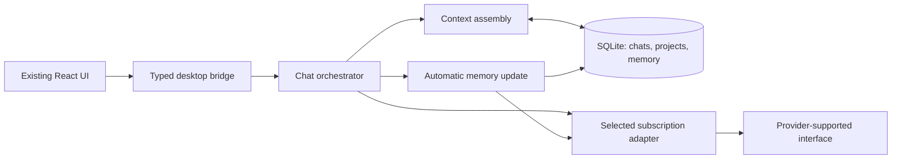

# Jarvis: subscription chat with shared memory

Status: proposed execution design, October 21, 2026. Product requirements below come from the brainstorming; implementation defaults are recommendations, not prior user approvals.

## Product and first release

Jarvis is a desktop chat app for people already paying for two or more AI subscriptions. They choose a model in one interface, continue working, and keep useful context across models, conversations, and projects. Their subscriptions fund inference. Jarvis maintains the shared memory.

The defining demo: tell model A a preference and a project decision; switch to B without pasting context; restart Jarvis, open a fresh conversation, and have B use both appropriately. Work on a second project and compare the two without mixing up their facts.

### Required by the user

- One desktop chat interface with a Cursor-style model picker.
- Use users' existing provider subscriptions.
- Automatic continuity when switching models.
- Automatically maintained memory across conversations and multiple projects.
- Start with an MVP, preserving these requirements.
- First pair: ChatGPT + Claude, confirmed during planning.
- MVP scope: text chat + switching + memory, confirmed during planning.
- Commercial launch: users pay a monthly Jarvis subscription for the app and shared memory, while retaining their separate AI subscriptions.
- The founder has both ChatGPT and Claude subscriptions available for the access test; exact plan eligibility still needs verification.

### Proposed defaults

- macOS first; preserve and extend the existing React/Vite UI.
- Implement the confirmed pair only. Grok/Gemini are later integrations; a blocked Claude route does not authorize substituting them.
- Native Work/Cowork/code-agent tools, uploads, voice, image generation, and provider-native history import are later capabilities.
- One user, one Mac, local storage. No team accounts or cloud sync.
- A minimal billing/entitlement service may hold account and payment metadata; chats, memory, and provider credentials stay outside that service.
- Electron main process owns integrations, SQLite, and memory; renderer owns presentation.
- Provider access is a prerequisite for the full MVP. An independent memory prototype may proceed with test adapters, but cannot count as a working subscription product.

Memory starts with conversations inside Jarvis. Connecting an account does not imply reading or syncing conversations or native memories from that provider's own apps. This boundary must be clear in onboarding.

## Feasibility gate

Research found integration patterns, not a verified four-provider product. See the [research record](../../research/2026-10-21-subscription-model-switching.md) for pinned source inspections and limits. No live subscriber request has been tested.

| Provider | Starting point | Decision needed before integration |
| --- | --- | --- |
| ChatGPT | Documented Sign in with ChatGPT route | Validate the paid-app path now. Official docs direct paid apps to an interest form and describe limited commercial availability; local open-source eligibility alone is insufficient. |
| Claude | Published, unmodified Claude Code hosting rules | Establish whether our paid custom chat experience is covered or requires approval. The native-binary exception does not automatically establish permission for custom subscription login or Agent SDK use. |
| Grok | Grok Build ACP | Verify subscription entitlement, general-chat fit, and intended distribution. |
| Gemini | Consumer wrapper restrictions found | Defer until a supported consumer-subscription route exists. |

The access milestone produces a dated evidence record for each candidate: route/version, eligibility, supported use, authentication flow, entitlement source, successful streamed response, cancellation, reauthentication, limitations, and prototype-versus-distribution status. Never put tokens or private prompts in this record.

**Pass:** two selected providers demonstrably serve requests against existing subscriptions through a supported route for the intended prototype; A → B → A works using an app-owned transcript. Neither request uses a separate API balance. Text-only operation can disable/reject agent tools.

**Blocked:** no qualifying second route or unclear entitlement. Report the precise dependency; retain the two-provider requirement. Do not hide API billing, substitute web scraping, claim mocks are live evidence, or interpret another app's implementation as provider permission. Provider clarification may be needed; no outbound message is authorized by this plan.

Assess commercial eligibility in the first access milestone, using the confirmed monthly paid-app model. Keep three results separate: supported local prototype, verified subscription-funded inference, and permitted paid distribution. The founder's subscriptions supply test accounts; they do not establish the third result. A locally working integration can support prototype progress while paid-launch eligibility remains unresolved.

Rechecked sources: [OpenAI paid-app path](https://developers.openai.com/siwc/token-sharing-open-source), [commercial availability](https://developers.openai.com/siwc/quickstart), [Claude hosting and authentication rules](https://code.claude.com/docs/en/legal-and-compliance), [Agent SDK approval requirement](https://code.claude.com/docs/en/agent-sdk/overview). These sources do not establish commercial eligibility for Jarvis yet.

## MVP experience

1. Connect two eligible accounts through provider-supported authentication. Show connected, expired, unavailable, or quota-limited status. Explain that selected context and automatic memory updates consume subscription usage.
2. Create a project or use General. A project has a name and optional aliases. Chats belong to one project or General; shared memory remains one app-wide collection.
3. Send a message; stream the response. The picker lists only models currently exposed by the connected integration. Show only supported controls. Remove placeholder models and cosmetic Auto/Fast/context options.
4. Switch models for the next turn. Prior messages stay visible; Jarvis supplies a bounded transcript, conversation summary, and relevant shared memory to the new provider.
5. Open another chat or project. Useful personal preferences carry across; project facts retain their origin. Referencing another project automatically retrieves relevant facts from it.
6. Inspect a small Memory view: fact, scope, source, updated time; edit or forget a fact. No per-message manual saving or approval is required for clear facts.

Account connection, project selection, memory inspection, stop, retry, and clear error states are the new core-prototype surfaces. Paid launch adds a compact Jarvis subscription/account surface and hosted checkout. Keep the current chat layout.

## Paid launch boundary

Use one monthly Jarvis plan initially. Users continue to pay OpenAI and Anthropic directly; Jarvis does not include or promise additional model quota. The founder's provider accounts are for testing, never a shared inference pool for customers.

After the core prototype validates the product, add hosted checkout, subscription management/cancellation, and server-verified app entitlement. Keep app entitlement separate from each provider's connection/usage state. A checkout success URL alone cannot unlock paid features. Handle renewal, duplicate/out-of-order billing events, failed payment, cancellation, and entitlement refresh.

Proposed access behavior: cancellation retains paid access through its paid-through date; after expiry, new inference and background extraction stop while local conversations/memory remain readable and exportable. A transient billing-service outage does not erase local data or interrupt an already accepted turn. Start with one plan; pricing, payment provider, and offline entitlement policy are decisions for the paid-launch task, not prerequisites for the local memory prototype. A no-charge usability pilot may precede billing, subject to the integration's distribution conditions.

## Architecture and contracts



`src/shared/contracts.ts` defines renderer-safe DTOs. `desktop/providers/types.ts` defines the runtime adapter contract. No renderer DTO includes credentials, arbitrary filesystem access, or shell execution.

Core types:

```ts
type ProviderId = 'chatgpt' | 'claude' | 'grok' | 'gemini';
type ConnectionState = 'disconnected' | 'connecting' | 'connected' | 'expired' | 'limited' | 'unavailable';
type RunState = 'queued' | 'streaming' | 'complete' | 'cancelled' | 'failed' | 'interrupted';
type MemoryScope = { kind: 'global' } | { kind: 'project'; projectId: string | null };
type MemoryStatus = 'active' | 'superseded' | 'conflicted' | 'deleted';
type ModelRef = { providerId: ProviderId; modelId: string };
type ModelDescriptor = ModelRef & {
  label: string; inputBudgetTokens: number;
  reasoningLevels: string[]; supportsTextOnly: boolean;
};
type TurnInput = {
  requestId: string; chatId: string; text: string;
  model: ModelRef; reasoning?: string;
};
type RunEvent =
  | { type: 'delta'; runId: string; text: string }
  | { type: 'state'; runId: string; state: RunState; error?: string }
  | { type: 'context'; runId: string; memoryIds: string[]; updating: boolean };
type ProviderEvent =
  | { type: 'delta'; text: string }
  | { type: 'done' }
  | { type: 'error'; code: 'auth' | 'quota' | 'network' | 'unsupported' | 'unknown'; message: string };
type ContextBundle = {
  instructions: string;
  messages: { role: 'user' | 'assistant'; content: string }[];
  memoryIds: string[]; updating: boolean;
};
type ProviderRequest = { model: ModelRef; context: ContextBundle; reasoning?: string };
interface SubscriptionAdapter {
  id: ProviderId;
  connect(): Promise<void>;
  disconnect(): Promise<void>;
  status(): Promise<ConnectionState>;
  listModels(): Promise<ModelDescriptor[]>;
  stream(request: ProviderRequest, signal: AbortSignal): AsyncIterable<ProviderEvent>;
}
```

Adapters translate instructions/history to the supported wire format. For example, the researched ChatGPT preview requires streaming, non-persisted requests and client-owned history; it does not support every standard API field. Model capability and budget data must come from a documented catalog or the supported discovery interface, recording their source. Unknown capability means unavailable control, not invented support.

The main process exposes a narrow `window.jarvis` bridge for account status/connect/disconnect, project/chat CRUD, `send(TurnInput): Promise<{runId: string}>`, `cancel(runId): Promise<void>`, `onRunEvent(listener): unsubscribe`, memory list/edit/forget, and legacy import. Each IPC input and sender is validated.

## Durable data and run behavior

SQLite owns projects, chats, ordered messages, runs, summaries, memories, memory sources, extraction jobs, and a migration ledger. Use transactions and foreign keys. Keep message IDs, provider/model attribution, timestamps, terminal run state, and extraction progress.

- User message + queued run persist atomically before requesting inference. `requestId` makes repeated IPC submission idempotent.
- One active run per chat; independent chats may run concurrently. Every event is keyed by run ID. A model change affects the next run only.
- Persist streamed output at most every 250 ms and on terminal events. A crash may lose the latest 250 ms of display text, not the user message or an already terminal reply. On restart, unfinished runs become interrupted; do not resubmit automatically.
- Retry creates a new attempt against the same user message; retain failed/cancelled partial output as such, exclude it from future assistant history. Only complete responses enter normal history.
- Deleting an active chat cancels its runs before removal and prevents late events recreating it.
- Import `jarvis.chats` from the existing browser UI through a validated file export/import when the browser and desktop origins differ. Also support direct import when the key is available in the desktop origin. Import is idempotent; preserve IDs and source data. Reject malformed entries with counts. Never erase the original automatically.

## Automatic memory

Each completed turn schedules one background update using the same connected subscription/model. The update returns a conversation summary and candidate durable facts. This is extra subscription usage, disclosed in settings. No separate paid API or hidden provider fallback. Store invalid/failed extraction as a pending job; do not break chat or silently claim memory was updated.

Memory records contain ID, scope, normalized subject/key, value, retrieval keywords, source user-message IDs, creation/update time, revision, status, and whether the user edited the record. Supply relevant existing keys, including tombstoned keys, to extraction so paraphrases reuse canonical identities. New facts must cite newly processed user messages; an older summary supplies context, not fresh evidence. Accepted facts require supporting user text. Assistant text can help summarize the discussion but is not evidence of the user's preferences or decisions. Explicit user adoption of an assistant proposal can become evidence. Ignore instructions inside quoted text, copied documents, or model output as memory-system commands.

Global preferences apply across projects. Project decisions retain project scope. With no active project, non-global facts use project scope with `projectId: null` (General); never guess a named project from an unrelated conversation. Enforce uniqueness for General keys explicitly because SQL NULL uniqueness alone is insufficient. Auto-capture clear facts; omit uncertain inferences.

Updates use subject/key + scope, not blind appends. Every persisted user message has a database-assigned, globally increasing source sequence. An explicit correction supersedes the old fact by source sequence, never by extraction completion time. Unresolved contradictions without an explicit correction are marked conflicted and excluded from asserted context; surface them for clarification when relevant. Manual edits are authoritative until the user changes them. A future explicit change to an edited fact becomes a review item rather than silently replacing it.

“Forget saved memory” tombstones a fact and suppresses automatic recreation from the same normalized subject/key + scope. A user can explicitly restore it in Memory. This removes saved-memory retrieval, not the original conversation: the UI states that source messages may still be sent when continuing that chat. It does not promise to retract information already sent to providers. Deleting a chat removes that chat's future transcript context, sources, jobs, and summaries, and deletes facts supported only by that chat, including edited facts. Facts with another surviving source, or copies explicitly present in another conversation, remain. Deleting a project applies this to its chats and project facts. Normal restart, reindexing, retries, and late extraction jobs must preserve these deletion boundaries.

Before another turn, wait up to 10 seconds for already queued updates relevant to its context. If still pending, include recent eligible source user messages within the same context budget and show “Memory updating”; never turn them into verified facts. Since not-yet-extracted facts have unknown scope, inspect pending user messages across the store for relevant evidence rather than assuming only the active project matters. Queue ordering is per chat and commits use revision checks to prevent stale results overwriting corrections. The newest unfinished work remains retryable across restarts.

## Retrieval and context limits

Start with SQLite FTS5 plus scope, recency, and explicit project-name/alias matching. One central index; project labels guide relevance rather than creating separate memory databases.

Eligible context includes global facts, the active project's facts, and facts from other projects named in the message. When no project is named/active, search all projects but include only relevant matches with project attribution. Requests explicitly comparing all projects permit broader retrieval. Never attach every project's full memory to every request. Ambiguous aliases trigger a short clarification rather than selecting arbitrarily.

Keep at most 12 retrieved facts, including at most 4 global facts, within 8 KiB UTF-8. Prefer relevant and recently confirmed facts. Store selected IDs on each run so the user can inspect what was shared.

For MVP, conservatively cap assembled textual input to `min(24 KiB, floor(inputBudgetTokens * 0.70) bytes)`, unless the adapter supplies a verified tokenizer that permits a tighter token-based calculation. The byte estimate reserves room for framing/output and deliberately underuses large windows. Include current user message first, then instructions, relevant memory, recent complete turns, and a bounded older-conversation summary. Never silently truncate the current user message: reject an over-budget send with an actionable error. Mark compaction in the UI; preserve the full local transcript. Provider-private reasoning state is not transferred.

Evaluate retrieval on fixed fixtures before adding infrastructure. Proposed release bar: at least 18/20 relevant-memory scenarios pass, including paraphrases and cross-project queries; all deletion, contradiction, and wrong-project negative cases pass. If FTS cannot meet this bar, treat local semantic retrieval as measured follow-up work required before release, not an untested claim that FTS is enough.

## Runtime and local privacy

Use Electron context isolation and sandboxing, no renderer Node integration, local bundled UI, a restrictive CSP, and a validated IPC allowlist. Reject tool execution in the text-only adapters. A general chat request must not inherit filesystem/shell permissions from an embedded coding agent.

Prefer provider-managed credential storage. If an authorized route requires app-owned secrets, keep them in the main process with Electron's asynchronous safeStorage APIs backed by macOS Keychain. Never expose credentials to renderer, database exports, or logs. Transcripts/memory are local SQLite data protected by OS permissions; do not claim application-level encryption. Relevant context is transmitted to the selected provider. Disconnect removes app-held credentials and stops new requests; it does not delete chat history. No content telemetry in MVP.

Technical references: [Electron security](https://www.electronjs.org/docs/latest/tutorial/security), [async safeStorage](https://www.electronjs.org/docs/latest/api/safe-storage), [SQLite FTS5](https://www.sqlite.org/fts5.html). Provider sources and their limitations are in the research record.

## Completion evidence

| Requirement | Proof |
| --- | --- |
| Existing subscriptions | Two live accounts; documented route and entitlement evidence; no API-key fallback |
| Switching | A → B → A in one thread; each follows prior visible context |
| Persistent shared memory | Fact from A used by B in a fresh chat after restart |
| Multiple projects | Relevant cross-project comparison works; unrelated facts stay out |
| Maintained memory | Correction, manual edit, forget, source deletion, stale-job replay tests |
| Reliable desktop app | Packaged macOS run; cancel, concurrent chats, expired auth, quota, crash recovery |
| Useful MVP | Proposed pilot: five users with two supported subscriptions, one week; at least four complete the defining demo without manual context transfer |
| Paid release | Commercial integration eligibility established; monthly checkout, renewal, cancellation, expiry, and local-data export accepted |

Packaging targets the development Mac's architecture first. Expand platform support after the pilot. Signing/notarization and distribution eligibility are required before an external download pilot. Pilot invitations are user-run unless sending them is separately authorized.

## Unresolved questions

- Do both integration routes cover Jarvis's paid distribution?
- Before paid launch: price, payment provider, offline entitlement policy?

Paid monthly distribution is confirmed. Local storage, macOS first, and the numerical memory budgets are implementation recommendations that can be adjusted from measured results without changing the confirmed product.
